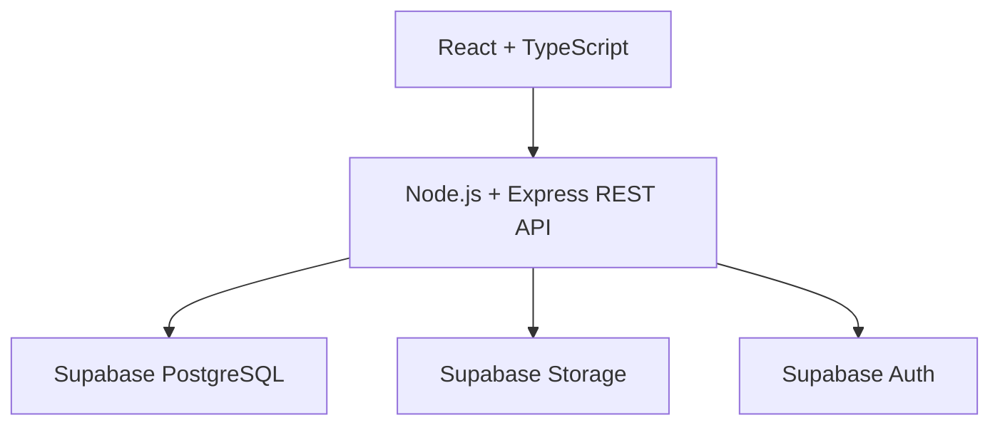

# Jerry's introduction Webpage

__An introduction about Jerry__

## Tech Stack
| Layer | Technology |
| - |:-:|
|Frontend|React + Typescript|
|Styling|Tailwind CSS|
|Backend|Node.js + Express|
|Database|Supabase PostgreSQL|
|Authentication|Supabase Auth|
|Storage|Supabase Storage|
|Animation|Framer Motion + Thres.js|
|Deployment|Vercel + Render|

### What it does?
|Technology|Purpose|
| - |:-:|
|React|Render profile pages, project cards, interactive components|
|TypeScript|Type-safe components, API responses, and application logic|
|Tailwind CSS|Styling, responsive layouts, UI design|
|Node.js|Execute your backend JavaScript/TypeScript|
|Express|Define API routes and handle HTTP requests|
|Supabase|Store profile, skills, projects, experience, and messages|
|Supabase Auth|Secure admin login|
|Supabase Storage|Store project screenshots and profile assets|
|Framer Motion|Animate transitions and interactive UI|
|Vercel|Deploy frontend|
|Render|Deploy backend|

## Features

|Feature|Description|
| - |:-:|
|About Me|Introduction, background, developer philosophy|
|Skills Explorer|Interactive technical skills and proficiency descriptions|
|Project Showcase|Detailed case studies, technologies, challenges, solutions|
|Developer Journey|Education, internship, experience, achievements|
|Contact System|Contact form with backend validation|
|Admin Dashboard|Manage projects, skills, profile information|
|Analytics|Track portfolio visits and project interactions|

## Architecture
> React + Supabase + Node

## Development Roadmap
|Phase|Deliverable|
| - |:-:|
|Phase 1|UI/UX design + project setup|
|Phase 2|Personal profile + project showcase|
|Phase 3|Express backend + Supabase database|
|Phase 4|Admin dashboard + authentication|
|Phase 5|Contact System + GitHub integration|
|Phase 6|Testing, deployment, documentation|

### Frontend
* Home / Introduction
* About Me
* Skills
* Projects
* Experience
* Contact

### Backend
* GET profile
* GET projects
* GET skills
* GET experience
* POST contact message
* Admin CRUD endpoints

### Database
* profiles
* projects
* skills
* experiences
* contact_messages

## Development Sequences
|Stage|What I've learn|
| - |:-:|
|01|React fundamentals, components, props, state|
|02|TypeScript interfaces and type-safe data|
|03|Tailwind CSS and responsive UI|
|04|Node.js and Express REST APIs|
|05|Supabase database and SQL|
|06|Frontend/backend integration|
|07|Authentication and admin CRUD|
|08|Testing, security, deployment|